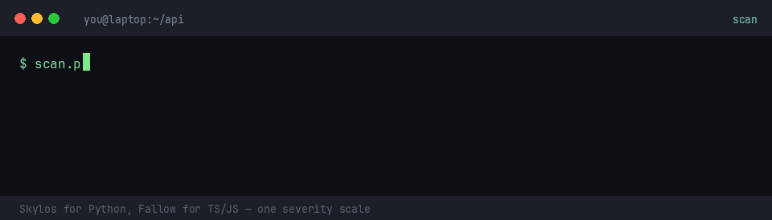

# code-scan

<h3 align="center">Skylos (Python) and Fallow (TS/JS) as one prioritised report, with a baseline gate.</h3>

<p align="center">
  <a href="LICENSE"></a>
  
  
  
</p>

> Two scanners, one gate: 3,623 findings triaged into 118 that matter, and CI that fails only on new ones.

Works in **pi · Claude Code · Codex · Cursor** and any agent that reads a `SKILL.md` — plain
Markdown plus one stdlib script, no agent-specific tools.

<p align="center">
  
</p>

## What it is

`code-scan` runs Skylos and Fallow, normalises both into one severity scale, and adds the thing neither has alone: a repository baseline so a gate is adoptable on day one. It reads a whole repo or only the diff, prints a PR-ready table, and can group findings into "delete" versus "needs a human".

## Why it exists

Two tools means two output shapes, two severity scales and two ways to drown in findings. Skylos grades cyclomatic complexity HIGH; a gate on that is noise. Here only secrets, security flows, vulnerable dependencies and a failed Fallow audit count as blocking.

## Install

```bash
# Claude Code — the whole collection as one marketplace
claude plugin marketplace add Appit-labs/appit-skills
claude plugin install code-scan@appit-skills

# pi
pi install git:github.com/Appit-labs/code-scan

# any agent that reads a skills directory
git clone git@github.com:Appit-labs/code-scan.git
cp -r code-scan/skills/code-scan ~/.claude/skills/      # or ~/.codex/skills/, .cursor/skills/, …
```

## Requires

- `pip install skylos` (Apache-2.0)
- `npm i -g fallow` or `npx fallow` (MIT)
- Nothing else: no account, no upload — `--no-upload` is always passed

## Cost

| | tokens |
| --- | --- |
| always-on — the description, paid every session | ~90 |
| on invoke | ~1.4k |

The demo is a real run: `demos/code-scan.json` holds the captured output and `tools/make_demo.py` renders it.

## Security

SkillSpector: **0/100, SAFE, 0 open findings** against the committed baseline; every accepted
finding is listed with its reason in [SECURITY.md](SECURITY.md).

## Part of the Appit collection

[appit-skills](https://github.com/Appit-labs/appit-skills) — browser QA · CI triage · Postgres ·
runbooks · SSH · Trello · cloud browsers · OpenDesign · Blender · code scan · release · Hermes.

## License

MIT, copyright Appit Labs. See [LICENSE](LICENSE).
